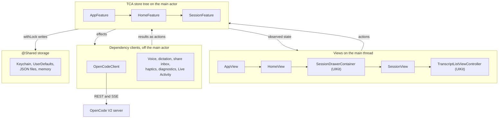
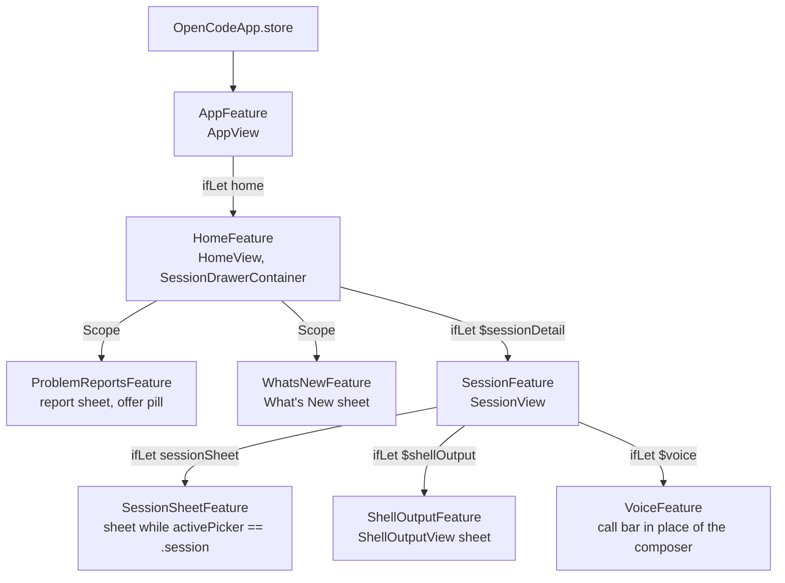
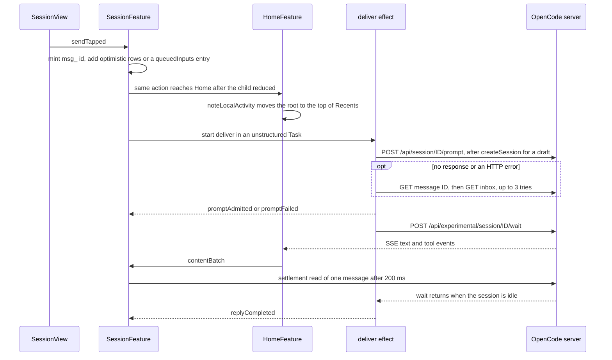

# OpenCode iOS architecture for the Android port

Source: `.upstream/opencode-ios` at commit `4fb5e0e`, read-only. Paths below are relative to that checkout, and line numbers match that commit. The iOS team keeps its product and architecture rules in the checkout's `AGENTS.md`, which this document cites by line.

This document is the map. The four explorer reports are the detailed reference, and the sections below link into them instead of repeating their tables.

| Report | Covers |
| --- | --- |
| [explore/protocol.md](explore/protocol.md) | Every HTTP route, wire shapes and their mapping to models, SSE framing and event mapping, pairing, error strings, on-disk formats |
| [explore/state.md](explore/state.md) | The TCA feature tree, reducer order, actions per feature, cancel IDs, dependency clients, `@Shared` keys, REST and SSE reconciliation rules |
| [explore/ui.md](explore/ui.md) | View hierarchy, design tokens, colors, motion constants, gestures, accessibility, haptics, Android analogs |
| [explore/platform.md](explore/platform.md) | Attachments, agent files, share extension, dictation, voice calls, Live Activity, diagnostics, problem reports, keychain, manifest analogs |

Where this document and a report disagree, this document was checked against the code. The disagreements are listed under [Where the explore files are wrong](#where-the-explore-files-are-wrong).

## Overview

OpenCode for iOS is a remote client for one OpenCode V2 server at a time. The phone pairs by scanning the QR code that `opencode pair` prints, or by typing an address and password. It then shows the server's sessions in a side drawer and one session full screen. The session screen has a transcript that streams the agent's text and tool calls, a composer that sends prompts with photos and files, a dock that answers permission and question requests, a capsule for running shells and subagents, and an optional voice call. The call talks to OpenAI with the user's own key and hands work to the session. A share extension queues items into a session's composer, and a Live Activity shows a running call. The app has no push notifications.

The app target is 86 Swift files (36,859 lines) plus one Metal shader. The share extension has 3 files (441 lines) and the widget extension 2 files (290 lines). Unit tests are 37 files (17,332 lines) and UI tests 15 files (5,898 lines). The app targets iOS 18 on iPhone only, builds with Swift 6 with `MainActor` as the default isolation, and uses The Composable Architecture (TCA) 1.26.2 ([platform.md](explore/platform.md#app-identity-lifecycle-permissions)).

The code has four layers.

1. Protocol. `OpenCode/OpenCodeClient.swift` (3,331 lines) is the only file that knows routes, JSON shapes, and SSE framing. Its request functions run off the main actor and return public model types such as `OpenCodeSession` and `OpenCodeTranscriptItem`. Its SSE subscription yields semantic `OpenCodeServerEvent` values with token deltas already coalesced.
2. State. Eight TCA reducers form one tree under a store that lives as long as the process. `AppFeature` connects, `HomeFeature` owns one server's session list and its event stream, and `SessionFeature` owns the open session. `SessionFeature.swift` alone is 3,027 of the 6,784 lines in the eight feature files. Every side effect goes through an injected dependency client, and `@Shared` keys persist preferences, caches, and keychain secrets.
3. Views. SwiftUI views read state from scoped stores and send actions. UIKit takes over where a per-frame loop or gesture arbitration matters: the transcript list, the composer text field, the drawer container, the Catch Up card stack, and a few smaller pieces.
4. Platform services. Attachments, the agent file viewer, the share extension, on-device dictation, voice calls, the Live Activity, diagnostics and problem reports, the keychain, and haptics. Most are dependency clients or view-local models. Voice and problem reports also have reducers.

Rules from `AGENTS.md` lines 6-9 decide most of the design. REST snapshots are authoritative and SSE only invalidates or projects, so every reconnect reloads from REST and a streamed row lives only until a REST read settles it. Protocol decoding and byte handling stay out of reducers, so reducers receive semantic events in bounded batches. The app speaks the current V2 API only, with no fallbacks for older routes.

## Key concepts

A short TCA primer for readers who have not used it. A `Store` holds a value-type `State`. Views send `Action`s. A `Reducer` mutates state synchronously and returns an `Effect`, which is async work that can send more actions. An effect can carry a cancel ID. `.cancellable(id:cancelInFlight: true)` cancels the running effect with that ID when a new one starts, and `.cancel(id:)` stops it. Child features attach with `Scope` (child state always present), `ifLet` (optional child state), or `ifLet` over a `@Presents` property (optional child with presentation semantics). `@Dependency` injects clients that have a live and a test value. `@Shared` declares state backed by storage. `@ObservableState` makes SwiftUI re-render a view only for the properties that view read.

Terms used throughout:

- Server identity. `OpenCodeServer` has two identities (`OpenCodeClient.swift:29-82`). `id` is the address currently in use. `persistenceID` is the username plus the sorted candidate URLs joined with `|`, and it survives a change of winning address. Phone-local records key on `persistenceID`, except the voice transcript map, which keys on `id`.
- Root, family, subagent, draft. A root session has no parent, and only roots appear in the drawer. A family is a root plus its descendants, which the client discovers itself with `sessionFamily`; the server has no family route. A subagent is a child session. A draft is a `SessionFeature.State` whose `session` is nil, and its first send or voice request creates the session.
- Home snapshot. `OpenCodeHomeSnapshot` holds the server's projects, the newest 50 roots, the server-wide set of active session ids, and the parents of active children (`OpenCodeClient.swift:384-390`).
- Transcript item, entry, and row. `OpenCodeTranscriptItem` (9 cases, `OpenCodeClient.swift:1222-1252`) is state. `TranscriptEntry` (4 cases, `Transcript/TranscriptEntry.swift:30-156`) is a view projection that groups items into list units. Stable diffable row ids belong to the list controller, which computes them with `TranscriptRowIdentityPlan`.
- Semantic part id. REST decoding and live upserts name a part the same way, `{messageID}-text-{ordinal}` or `{messageID}-tool-{toolID}` (`OpenCodeClient.swift:1367-1381`). The shared id is what lets a REST read replace a streamed row.
- Live projection. While a run streams, `SessionFeature.State` keeps the raw text of each part in `liveText`, the messages it has projected in `projectedMessageIDs`, and the latest one in `lastProjectedMessageID`.
- Durable boundary and settlement. The end of a text, reasoning, tool-input, or step part, and a tool call, success, or failure, are durable boundaries (`isDurableBoundary`, `OpenCodeClient.swift:1358-1365`). A boundary schedules a settlement, a REST read of that one message.
- Refresh. At most one authoritative read is in flight per session. `State.refresh` holds its id, its `RefreshReason`, at most one follow-up reason, and the live events that raced it.
- Pending message. A prompt the server has admitted but not delivered yet. A steering message (`delivery: "steer"`) lands at the next step and shows as a dim bubble in the transcript. A queued message (`delivery: "queue"`) waits for the run to end and sits in a pill above the composer. The server lists both in the session inbox.
- Pending request. A permission or a form waiting on the user, where questions arrive as forms. A root with a pending request anywhere in its family has attention, which the drawer shows as an orange dot.
- Location scope. Location-scoped routes take a `location[directory]` query. Such a read makes the server boot that folder's whole service graph, MCP processes included, and keep it for an hour (`AGENTS.md` line 9, `HomeFeature.swift:1347-1353`). The client limits these reads to a small hot set.
- `navigationID`. Home gives each opened `SessionFeature.State` a fresh `navigationID`, which is also its `Identifiable.id`. TCA cancels a presented child's effects when that id changes, so the id is the lifetime of every effect the session started.
- Delegate action. A child asks its parent to act through a nested `Delegate` enum. `SessionFeature.Action.Delegate` asks Home to open a session, toggle a pin or read state, or delete a session.
- Catch Up. A card stack of unread and waiting roots. Swiping a card right marks it read, and swiping left keeps it unread.

## How it works

### Process, targets, and lifecycle

`OpenCode/OpenCodeApp.swift` is the `@main` app. It builds one `static let store = Store(initialState: AppFeature.State()) { AppFeature() }` and, in `init`, ends any Live Activity left by an earlier process, because a call does not survive process death. Its scene is `WindowGroup { AppView(store:) }`. Nothing else creates a store except the inert preview stores behind Catch Up cards (`CatchUpPreviewStores` in `CatchUpStack.swift`).

Views handle scene phase, not the app struct. `AppView` sends `.pendingSharesRequested` when it first appears and whenever the scene becomes active (`AppView.swift:29-35`). `HomeView` sends `.retryConnectionTapped` on active, which restarts the event stream and refreshes the snapshot. On inactive or background it sends `.transcriptCacheFlushRequested`, which writes the transcript cache and publishes share targets (`HomeView.swift:83-90`). `SessionView` maps scene phase to `.visibilityChanged` (`SessionView.swift:904-910`).

The share extension (`OpenCodeShare/`) and the widget extension (`OpenCodeWidgets/`) are separate targets. The share extension never talks to a server. It writes a queue into the App Group container `group.ai.opencode.mobilecode`, and the app consumes it. The widget renders only the voice call's Live Activity, and its buttons are `LiveActivityIntent`s that run in the app process. `project.yml` compiles `ShareHandoff.swift`, `AttachmentFileType.swift`, and `LiveActivity/VoiceCallActivity.swift` into more than one target. The app registers no URL scheme and no universal link. `opencode-file` and `opencode-stream` are in-process schemes only ([platform.md](explore/platform.md#10-app-lifecycle-plist-entitlements-projectyml)).

### The store tree and its rules

`AppFeature.State.home` is a plain optional. When it is nil, `AppView` shows the connection screen. `HomeFeature.State.sessionDetail` is a `@Presents` optional that is never nil in practice, because Home always holds the remembered session or a draft, and `HomeView` renders nothing without it (`HomeView.swift:25`). `SessionSheetFeature` is a plain optional that outlives its sheet, so a fork or export in flight still lands. The sheet itself shows while `activePicker == .session`. `ShellOutputFeature` and `VoiceFeature` are `@Presents` children. Problem reports and What's New are `Scope`d, so they always exist and never tear down. Action lists and fields per feature are in [state.md](explore/state.md#per-feature-contracts), and the presentation table is in [state.md](explore/state.md#navigation-and-presentation-state).

Five rules govern how the tree runs, and each is easy to lose in a port.

1. The child reduces first. `ifLet` runs the child reducer, then the parent, then cancels the child's effects if the child became nil or changed identity. Parents therefore read the child's post-action state. Home's handler for `.sessionDetail(.presented(.sendTapped))` checks that the draft is already empty and the session awaits a reply before it moves the session to the top of Recents (`HomeFeature.swift:604-610`, pinned by `sendingMovesTheSessionToTheTopOfRecentsBeforeTheServerCatchesUp` in `HomeFeatureTests.swift`). App handles `.home(.serverBadgeTapped)` by setting `home = nil` after Home has reduced the action (`AppFeature.swift:374-379`). `Scope`d children come before Home's main `Reduce` in its body, so they also run first for their own actions.
2. Order in `body` is behavior. Each feature's `body` lists `BindingReducer`, child scopes, the main `Reduce`, `ifLet`s, `onChange(of:)` hooks, and trailing `Reduce`s in a fixed order. Home's main `Reduce` has a `defer` that absorbs shared drafts and persists the snapshot, followed by two trailing reducers that start queued uploads and reconcile Catch Up (`HomeFeature.swift:510-1156`). The order for every feature is in [state.md](explore/state.md#reducer-composition-order-must-be-preserved).
3. Effects are keyed. Every long-lived effect has a cancel ID, usually with `cancelInFlight: true` so a restart replaces it. The tables are in [state.md](explore/state.md#per-feature-contracts). Two exceptions matter. `SessionFeature`'s authoritative read uses `CancelID.freshness` without `cancelInFlight`, because a newer request becomes a follow-up instead of cancelling the read in flight (`SessionFeature.swift:968-990`, `2763`). `deliver` runs the prompt POST in an unstructured `Task` and awaits it, so cancelling the effect stops the reporting but never the delivery (`SessionFeature.swift:2507-2550`).
4. Identity is lifetime. `makeDetail` and `makeDraft` assign `navigationID` from `detailGeneration` (`HomeFeature.swift:123-175`). Switching sessions in the drawer swaps in a state with a new id, which cancels the old session's polls, dictation, uploads, and timers. A live voice call keeps the old id so its effects survive the move. A draft with no folder to move the call to gets a new id, which ends the call. `familyPicked` keeps the id and cancels its effects by cancel ID instead (`SessionFeature.swift:1672-1675`).
5. Responses name their request. Every response action carries what it answers, and the reducer drops stale ones: `attemptID` against `ConnectionAttempt.id` in App, `requestID` and the session id against `refresh.id` in Session, `historyGeneration` and `earlierHistoryGeneration` for history pages, and `requestEpoch` for prompt echoes. Effects copy what they need (`let server = state.server`) before `.run` and never capture state.

Clients are structs of `@Sendable` closures with a `liveValue` and a `testValue`. `OpenCodeClient` is written by hand rather than with `@DependencyClient`, because its endpoints throw the typed `OpenCodeClientError` (`OpenCodeClient.swift:1477-1546`). Its `testValue` is the live client with only `contextUsage` stubbed, so a test that forgets an override makes a real network call (`OpenCodeClient.swift:1592-1600`). Every client with its live and test behavior is in [state.md](explore/state.md#dependency-clients).

`@Shared` keys are declared in `SharedKeys.swift`, `Keychain.swift`, `WhatsNew/WhatsNewFeature.swift`, and `ProblemReports/PhoneReportsDelivery.swift`. Anything with a password or API key goes to the keychain. A few toggles go to UserDefaults, caches and phone-local records go to JSON files in Documents, Caches, and Application Support, the upload-unsupported set stays in memory, and the transcript cache uses a custom key that writes on a 500 ms debounce. A write is a synchronous `withLock` that every holder of the key sees at once, with no action involved. Settings writes `voiceModeEnabled`, `voiceEngine`, and `openAIAPIKey` straight from the view (`SettingsView.swift:96-114`), and `SessionFeature` reads them. Keys, types, and files are in [state.md](explore/state.md#shared-keys) and [protocol.md](explore/protocol.md#persistence).

Not everything is reducer state. View-local `@State` holds the drawer's open flag (`HomeView.swift:14`), the attachment menu phase, the jump-to-latest button, image previews, the queued-messages sheet, the background panel's visibility, and the large-upload alert (`SessionView.swift:743-766`). `@Observable` classes hold view models that never enter the store: `TranscriptDisclosureState` (which tool groups are expanded), `InlinePhotoSelection`, `ComposerImageImporter`, `ComposerFileImporter`, `AttachmentMenuAnchors`, `AgentFileViewerModel`, the camera's `AttachmentCameraState`, and `ProblemReportHub` with its presenter. The share extension uses its own `@Observable` `ShareModel` instead of TCA. `UndeliveredPrompts` and the share inbox are process services outside feature state.

Observation is per property. `SessionView` puts the transcript in a separate child view, `SessionTranscriptView`, so composer keystrokes do not rebuild the transcript and streamed items do not rebuild the composer (`SessionView.swift:829-843`, `2189-2236`).

### Launch and connecting: AppFeature

`AppFeature.State.init` builds the first frame before any action runs (`AppFeature.swift:33-66`). If the keychain has a saved server, `init` builds `home` right away. It uses the cached home snapshot when the cache's `serverID` matches the server's `persistenceID`, and an empty snapshot otherwise. It marks Home `.reconnecting` and turns off request-load errors until Home hears from the server. `HomeFeature.State.init` then restores the in-memory transcript cache from disk and opens the root remembered for that server, or a draft (`HomeFeature.swift:102-121`). The remembered session's cached transcript paints before any network call.

`AppView.task` sends `.task` and `.pendingSharesRequested`. `.task` connects only when `connection == .idle` and `home == nil` (`AppFeature.swift:247-255`). With a saved server, `init` has already built Home, so `.task` does nothing, and `HomeFeature.task` revalidates by starting the event stream and a snapshot refresh. Without a saved server, the setup screen waits for a scan or a manual entry.

Pairing starts from the scanner or a pasted link (`pairingCodeScanned`, `AppFeature.swift:321-338`). `OpenCodePairingLink.decode` accepts the `opencode pair` JSON `{"code","urls"}` or the older `https://host/auth/connect/{code}` link. The app refuses a code whose URLs are all loopback before it spends the code. `redeem` calls `GET /auth/connect/{code}` on every non-loopback candidate at once without credentials, keeps the first success, and uses the returned token as the password with username `opencode` (`OpenCodeClient.swift:1608-1679`). `pairingRedeemed` then runs the normal connect. Parsing rules and failure strings are in [protocol.md](explore/protocol.md#pairing).

`connect` (`AppFeature.swift:524-579`) sets `.connecting`, sets `home = nil`, bumps `connectionGeneration`, and probes every candidate URL with `GET /api/info` in parallel. `OpenCodeServer.reachabilityRank` orders addresses public, then tailnet, then private LAN, then loopback, with HTTPS ahead of HTTP within each scope. `connect` waits until every better-ranked probe has finished, takes the best success, and cancels the rest. `healthResponse` moves to `.loadingHome`, saves the server to the keychain with `remember()` unless an edit is in progress, and fetches the home snapshot. `homeResponse` builds `HomeFeature.State(server:snapshot:)`, persists the snapshot, sets `.connected`, and hands Home any shares that were waiting for this server.

The credential form uses `BindingReducer().onChange(of: \.server)`. A real edit while an attempt is in flight cancels it, and a value the text field flushes after the form closed retries with the completed entry. Unchanged bindings must not cancel anything (`AppFeature.swift:227-240`, [state.md](explore/state.md#bindings-bindableaction--bindingreducer)). Change Server in Settings sends `.home(.serverBadgeTapped)`. App records `returnServer`, sets `home = nil`, and moves to `.picking` so `.task` will not reconnect. `ifLet` cancels all of Home's effects, and App's `onChange` ends the Live Activity, because Home can no longer see the call end (`AppFeature.swift:458-464`). A failed attempt shows an error card with a copyable report built from `FailureContext`, which keeps only a host and port ([protocol.md](explore/protocol.md#connection-error-reporting)).

### One server's live state: HomeFeature

`HomeFeature` owns the session list, the event stream, attention and read state, pins, deletion, the transcript cache, Catch Up, shared drafts, the voice Live Activity projection, and the open `SessionFeature`.

`HomeFeature.task` starts `eventStream`, refreshes the snapshot if Home is not connected yet or only attention if it is, and subscribes to Live Activity button commands (`HomeFeature.swift:612-629`). `eventStream` (`HomeFeature.swift:1227-1267`) is the reconnect loop, because `OpenCodeClient.events` is a single socket that throws when it ends. The loop tries each candidate URL in turn. On `server.connected` it resets the backoff and sends `.serverConnected(candidate)`, which makes the answering address primary. Every other event becomes `.serverEvent`. A 401 sends `.eventStreamFailed` and ends the loop for good. Any other failure sends `.connectionLost` and moves to the next address. After a full pass the loop sleeps 1, 2, 4, 8, then 15 seconds plus up to 400 ms of jitter, or 1 second if the pass connected. A timeout after a live connection also files a stalled-stream problem report. `.retryConnectionTapped`, sent on every foreground, restarts the loop because the effect is `cancelInFlight`. Details are in [protocol.md](explore/protocol.md#reconnect-and-stall).

`.serverConnected` stores the new server, sets `hasConnected`, and sends two actions (`HomeFeature.swift:668-675`). `.serverEvent(.connected)` refreshes the snapshot and sends the open session `.familyRefreshRequested`, which re-reads its family and its running shells (`SessionFeature.swift:1684-1685`). `.eventStreamConnected(server)` tells the open session the socket is new. The session then clears its delta accumulators, keeps the rows it protects, marks every shell as listed so the re-list replaces it, retunes its polls, and requests a `.reconnect` read unless one is already in flight (`SessionFeature.swift:900-918`). The new address reaches the keychain on the next snapshot, which calls `server.remember()` (`HomeFeature.swift:887`).

`refreshSnapshot` sleeps 250 ms, then calls `homeSnapshot`, under `CancelID.refresh` with `cancelInFlight` (`HomeFeature.swift:1325-1342`). That sleep is the only debounce. A burst of events restarts the effect, and the older response is dropped. `runsStartedDuringRefresh` is cleared when a refresh starts and applied over the response, because the server read `/api/session/active` before those runs began. `snapshotRefreshed` (`HomeFeature.swift:818-908`) merges with care. It drops recently deleted ids, keeps a local send time that is newer than the server's, keeps local read receipts the server has not caught up with, and carries the open root and pinned roots that fell off the 50-row page instead of deleting them. If the open root is missing even after that carry, it opens a draft. It drops cached transcripts whose `updatedAt` changed, sets `connectionStatus = .connected`, saves the server again, and refreshes attention and prefetch. For the open session it forwards `sessionSnapshotUpdated`, `externalRunStateChanged` when the run state differs, and `requestsConnectionChanged(true)` on the first connect.

`.serverEvent` routes each semantic event (`HomeFeature.swift:708-795`). List events change Home directly: rename and delete edit the list, execution start and end edit `activeSessionIDs`, and created, viewed, and ended events refresh the snapshot. Session events go to the open session only when the ids match, which covers content batches, invalidations, and inbox changes. Content for any other session is dropped, and the next snapshot recovers it. Attention events light a listed root at once, refresh attention, and tell an open session to re-read its requests. The full table is in [state.md](explore/state.md#sse-consume-and-fan-out).

`refreshAttention` waits 150 ms and calls `homeAttention` for at most 8 directories: those of running roots, roots already flagged, and the open session, newest first (`attentionDirectories`, `HomeFeature.swift:1344-1380`). It runs on connect, after each snapshot, and on attention events. Nothing polls it on a timer, because each directory boots server services.

A root is unread if the user marked it unread, or if its idle watermark is newer than its viewed watermark, or, when the server sends no watermarks, if its read date is older than `updatedAt` (`isUnread`, `HomeFeature.swift:321-327`). Opening a session posts its idle watermark to `POST /api/session/{id}/view` (`acknowledgeView`). `indicator(for:)` returns attention, running, unread, or none. It returns none for every row unless Home is connected, or is reconnecting after a live stream in this process (`HomeFeature.swift:386-396`). A cold launch from cache therefore shows no dots until the stream connects or the first snapshot lands.

Pins are an ordered array of `persistenceID|sessionID` keys stored in the legacy file `followed-sessions.json`. Deletion has two phases. `hideSession` removes the row and keeps a `DeletionBackup`. Phone-local pins, read dates, and cache entries go only when `DELETE /api/session/{id}` succeeds, and a failure restores the row and shows an error for 3 seconds (`HomeFeature.swift:1050-1093`, `1163-1200`).

`sessionTapped` (`HomeFeature.swift:975-1009`) records the last-viewed root and marks it read. With a cached transcript, it builds the detail at once. Without one, it starts `transcript(limit: 12)`, sends `.sessionNavigationReady` so an empty detail appears while the request runs, then sends `.selectedTranscriptResponse`. The SwiftUI `SessionView` keeps its identity across the swap. Its `.task(id: store.session?.id)` runs again, and `.id(store.session?.id)` on the transcript resets the list (`SessionView.swift:843`, `900-903`).

Memory holds up to 8 cached transcripts of the last 30 items each (`publishTranscript`, `trimTranscriptCache`). Disk holds the open session plus the 3 hottest, at most 16 entries and 4,000,000 bytes across all servers, valid only while `updatedAt` matches (`persistTranscriptCache`, `SharedKeys.swift:12-79`). After each snapshot, `prefetchTranscripts` warms up to 3 uncached hot rows 50 ms apart, and only after the open session's own read has settled (`HomeFeature.swift:1274-1297`). Formats are in [protocol.md](explore/protocol.md#transcript-snapshot-cache).

`catchUpTapped` builds `CatchUp(queue:returnSessionID:returnComposer:)` from unread and waiting roots and opens the top card with `readsOnView = false`, so the card appearing does not mark it read (`HomeFeature.swift:279-310`, `532-591`). The swipe marks it read. Undo puts the card back and cancels its view receipt. A trailing reducer runs `reconcileCatchUp` after every action that is not transcript traffic, so reads and answers from other devices update the queue.

`sharesReceived` groups shared items into `sharedDrafts`, keyed by session or by the new-session target. The `defer` in Home's main reducer calls `absorbSharedDrafts`, which moves a draft into the open composer through `SessionFeature.State.absorb` (`ShareInbox.swift:84-93`). A trailing reducer then sends `.queuedUploadsStarted` for any staged files (`HomeFeature.swift:1140-1144`).

### The open session: SessionFeature

The `SessionFeature` state fields are grouped in [state.md](explore/state.md#sessionfeature--95-actions). This section follows a session from open to reply. The diagram shows the live update path, which crosses the client, Home, Session, and the transcript controller.

```mermaid
flowchart LR
  SRV["OpenCode server"] -- "GET /api/event" --> SUB["subscribeEvents<br/>decodeStreamFrame<br/>serverEvent(from:)"]
  SUB --> BAT["EventBatcher<br/>75 ms or 256 events"]
  BAT -- "bufferingNewest(128)" --> LOOP["HomeFeature.eventStream<br/>reconnect loop"]
  LOOP -- ".serverConnected, .serverEvent" --> HOME["HomeFeature<br/>serverEvent fan-out"]
  HOME -- ".contentBatch for the open session" --> LIVE["SessionFeature<br/>applyLiveEvent"]
  LIVE -- "durable boundary" --> REQ["refreshRequested(.settlement)<br/>authoritativeRefresh"]
  REQ -- "GET one message or the newest page" --> SRV
  REQ -- ".refreshResponse" --> MERGE["applyAuthoritative<br/>mergeTranscript"]
  LIVE --> ITEMS["SessionFeature.State.items"]
  MERGE --> ITEMS
  ITEMS --> STV["SessionTranscriptView<br/>TranscriptEntry.build"]
  STV -- "Configuration" --> TLC["TranscriptListViewController<br/>diffable snapshot, motionLink"]
```

#### Opening

`SessionView.task(id: session.id)` sends `.task` (`SessionFeature.swift:1118-1135`). A draft only loads models, prepares dictation, and restores an undelivered prompt. A session also requests `.refreshRequested(.open)`, unless Home is already fetching its first window. When the transcript list has drawn its first content frame, the controller sends `.firstContentFrameRendered` (`TranscriptListViewController.swift:1345`). That loads the family, running shells, and models, and requests `.open` again if the window is not fresh yet (`SessionFeature.swift:1137-1152`). For a tap without a cached transcript, this second request is what grows the 12-message first frame to the 30-message window. `visibilityChanged(false)` abandons the read in flight, and coming back requests `.resume`. A slow read shows a resync shimmer after 150 ms and keeps it for at least 300 ms.

#### The read machine

`refreshRequested(reason)` starts an authoritative read only when none is in flight (`SessionFeature.swift:968-1010`). Otherwise it keeps a stored `.runState` follow-up over anything newer and absorbs a settlement for the message already being settled. While a settlement is in flight, any other reason becomes the single follow-up. While a page read is in flight, only an invalidation, settlement, or run-state reason does, and lifecycle duplicates such as a second `.open` are dropped. `authoritativeRefresh` (`SessionFeature.swift:2716-2764`) has two shapes. For a settlement whose message is already in `items`, it sleeps 200 ms, which is the window that coalesces the text, tool, and step endings of one message, and then reads that one message, plus context usage only if a step ended. Otherwise it reads the session metadata, the newest 30 messages, and context usage. `refreshResponse` (`SessionFeature.swift:1012-1068`) drops any response whose id is not the one in flight. It applies the result, replays raced events, updates context and the observed session, sends Home the accepted window so Home can cache it, posts a view receipt, and sends the follow-up.

#### Live projection

A `.contentBatch` for the open session (`SessionFeature.swift:920-962`) marks the session as running (`isExternallyActive`) and the stream as healthy with projection proven. It appends every event except text deltas to `refresh.racedEvents` (capped at 512), records projected message ids, and applies each event with `applyLiveEvent` (`SessionFeature.swift:2882-2937`). A text delta appends to `liveText[partID]` and parses the whole accumulated string into markdown blocks again, reusing unchanged code fences. `text.ended` replaces the row with the final text and clears the accumulator. Tool input changes apply only while the tool is `.streaming`, `tool.called` moves it to `.running`, progress never revives a finished tool, and success or failure always overwrite. Reasoning and step events create no rows, and `step.ended` sets `contextNeedsRead`. If the batch contains a durable boundary, the reducer requests a settlement for the message that boundary belongs to, preferring a boundary that projected a row.

#### Merging a REST window

`applyAuthoritative` calls `acceptWindow`, which calls the pure `mergeTranscript` (`SessionFeature.swift:746-821`, `2766-2799`). The merge keeps everything older than the fetched window, adopts the window, and carries client-only rows forward: optimistic prompt rows still waiting for their echo, `info-` rows such as send failures, and projected rows REST has not returned yet while the run continues or a run-state follow-up is pending. Carried projected rows return to their place before the next surviving row, not to the end. Then `liveText` is upserted again by part id, so unfinished text is replaced and never appended twice. A single-message settlement does the same for that message's rows only (`applyAuthoritativeMessage`, `SessionFeature.swift:2820-2844`). Raced events replay only onto parts the read replaced or never returned (`SessionFeature.swift:1047-1050`). All sixteen rules, in the order the code applies them, are in [state.md](explore/state.md#rest-vs-sse-transcript-reconciliation).

#### Sending

`sendTapped`, `queueTapped`, and `returnKeyTapped` build a `PendingPrompt` with a client-minted id, `"msg_"` plus an uppercase UUID without hyphens (`SessionFeature.swift:1298-1385`). Send and Return steer by default. A send while uploads are still running waits for them in `sendAfterUploads`, and a failed upload blocks it. When the session is idle, the reducer appends optimistic user rows and records them in `optimisticPromptIDs`. During a run it appends no bubble. It adds the prompt to `queuedInputs` with the chosen delivery, and the view shows a steering prompt as a dim bubble and a queued one in the pill.

`deliver` (`SessionFeature.swift:2499-2575`) does its network work in an unstructured `Task`. For a draft it first creates the session and switches its model. It posts `POST /api/session/{id}/prompt`. On failure it checks whether the server got the prompt anyway by reading the message and then the inbox, up to 3 times 1 second apart when no HTTP status came back, or once after an HTTP error. A confirmed send dispatches `promptAdmitted`, waits on `POST /api/experimental/session/{id}/wait` (600 s), and dispatches `replyCompleted`, which the reducer treats like the run ending (`externalRunStateChanged(isRunning: false)`). Tokens arrive over SSE in the meantime.

A failed send is first parked in `UndeliveredPrompts`. If the screen is still there, `promptFailed` (`SessionFeature.swift:1512-1541`) discards that copy, removes the optimistic rows, puts the text and attachments back in the composer, and appends a `sendFailure` row with Try Again. If the screen is gone, the next `.task` restores the draft from `UndeliveredPrompts`. A failure with no HTTP status is also recorded in `unconfirmedSendFailures`, and if its echo turns up later, `settleUnconfirmedSends` removes the failure row and takes back the restored draft unless the user has edited it. Home moves the session to the top of Recents on the same `sendTapped` action, after the child has reduced it.

#### Pending messages

The inbox is read on `inputEnqueued` and `inputQueueChanged` events and by a poll (`SessionFeature.swift:1154-1165`, `2625-2656`). Send Now switches a queued message to steering with `PATCH /api/session/{id}/inbox/{inputID}`, and Cancel is a `DELETE` on the same path. A message leaves the queue when a transcript read echoes its id. `reconcilePromptEchoes` then moves the id into `promotedPromptIDs`, which keeps the last 32, so a slow inbox read cannot bring it back (`SessionFeature.swift:2846-2859`). An empty inbox alone never means delivered. A pending steering bubble and the delivered user group share one row identity, planned by `TranscriptRowIdentityPlan` (`Transcript/TranscriptEntry.swift:174-274`), so the bubble brightens in place instead of being replaced.

#### Pending requests

`familyPendingRequests` reads `GET /api/permission/request` and `GET /api/form` for the session's folder, filters them to the family, and keeps forms owned by `global` (`OpenCodeClient.swift:2464-2474`). Two polls, one for requests and one for the inbox, run every 2 seconds until the stream is healthy and every 12 seconds after (`SessionFeature.swift:2625-2675`). While any request is pending, a banner replaces the composer and `sendTapped` does nothing. `RequestReviewView` renders permissions and forms from `FormModels.swift`, and form answers go through `formValueChanged` actions, not bindings. `completedRequestIDs` keeps a slow poll from restoring an answered request. A failed read is an error, never an empty list ([protocol.md](explore/protocol.md#forms-and-permissions)).

#### History, family, and shells

Earlier history pages 40 messages at a time through an opaque cursor chain that first seeks overlap with the current window (`loadEarlierHistory`, rule 12 in [state.md](explore/state.md#rest-vs-sse-transcript-reconciliation)). The family comes from `sessionFamily`, a breadth-first walk of child lists with at most 6 requests in flight and 100 sessions ([protocol.md](explore/protocol.md#family)). `familyPicked` swaps the visible member inside the same detail. Running shells come from `GET /api/shell` for the session's folder on open, on reconnect, and on family switch, plus `shell.created`, `shell.exited`, and `shell.deleted` events. `backgroundShells` counts a shell only once it outlives its tool call, is a user `!` command, or was listed without an owning call (`SessionFeature.swift:355-371`). When a running shell or subagent tool has blocked the run for 3 seconds, `onChange(of: \.foregroundWork)` offers Move to Background (`SessionFeature.swift:2205-2220`), which calls `POST /api/session/{id}/background`. `ShellOutputFeature` pages a shell's output by byte cursor, polling only from its sheet's `.task`.

#### Pickers, the session sheet, and context

`activePicker` (`.model`, `.project`, `.requests`, `.session`) is one bound optional that drives one `.sheet(item:)` (`SessionView.swift:866-873`). `SessionSheetFeature` renames, compacts, forks, and exports, and it asks Home through delegate actions to pin, mark read, or delete. The context ring shows `contextUsage.tokens` over the model's `limit.context`. Context is read with page refreshes and after `step.ended`, never polled (`SessionFeature.swift:219-233`).

#### Timers

The watchdog requests a `.watchdog` read every 20 seconds when the stream is healthy and has delivered content, every 3 seconds while a run is active without proven projection, and every 30 seconds otherwise, plus a per-session jitter (`SessionFeature.swift:2593-2619`). The watchdog and the request auto-retry are off in tests unless a test opts in. The pending-work polls sleep with `Task.sleep`, while every other timer sleeps on the injected `continuousClock`, so a `TestClock` does not advance the polls.

### Inside OpenCodeClient

`OpenCodeClient.swift` holds several layers in one file. In order, it has `OpenCodeServer` and its URL helpers (`29-186`), `OpenCodePairingLink` (`194-263`), the public models (`265-1300`) including the markdown parser `OpenCodeMarkdownBlock.blocks(from:)` (`799-1100`), the two event enums and `EventBatcher` (`1301-1470`), and the `OpenCodeClient` struct with its 38 endpoints (`1480-1546`). One extension (`1548-3292`) then holds the live and test values, a private `request*` function per endpoint, the shared `request` and `perform` (`2768-2848`), the SSE subscription (`2850-2905`), `serverEvent(from:)` (`3004-3130`), and the private wire payloads. The `DependencyValues` accessor is at the end (`3326`).

`perform` builds the URL with `endpoint(path:query:)`, which replaces any path, query, or fragment in the saved address. It sets `Accept: application/json` on every call, `Content-Type: application/json` only when there is a body, and `Authorization: Basic` only when a password is set. The default timeout is 10 seconds. It maps a 401 or any other non-2xx status to an `OpenCodeClientError` with that status code, and maps every transport failure, cancellation included, to `"Couldn’t reach the OpenCode server"` with no status (`OpenCodeClient.swift:2782-2848`). Decoding uses a default `JSONDecoder`, and a mismatch becomes `"The server response does not match the current OpenCode V2 contract."` Every route, timeout, body, and response shape is in [protocol.md](explore/protocol.md#http-routes).

Private `Decodable` payloads never leave the file. `transcriptItems(for:)` turns one wire message into rows: user text, images, and files; assistant text and tool parts, with reasoning dropped; and shells, skills, compactions, and synthetic notices (`OpenCodeClient.swift:1830-1927`). Defaults are lenient where the UI can cope. An unknown tool status becomes completed, an unknown shell status becomes exited, an unknown inbox delivery becomes steer, and unknown message or event types are skipped. Forms and permissions are strict, so one unknown enum value fails the whole list. Markdown for REST rows is parsed here, off the main actor, and the parsed `AttributedString`s with their syntax colors are part of the model. The mapping tables are in [protocol.md](explore/protocol.md#message--transcript-items).

`subscribeEvents` (`OpenCodeClient.swift:2860-2905`) opens `GET /api/event` on a dedicated `URLSession` whose 90-second request timeout resets on the server's heartbeat comments. It reads lines, parses each `data:` line as one JSON value, throws on a frame over 16 MiB or a `_tag` failure frame, and skips anything it cannot map. `serverEvent(from:)` maps wire types to the 14 `OpenCodeServerEvent` cases, and the 16 `OpenCodeLiveContentEvent` cases travel inside `.contentBatch`. `EventBatcher` flushes pending content before it yields any other event, merges adjacent deltas for the same part, and flushes after 75 ms or 256 events. The stream buffers the newest 128 events. Framing and the full type map are in [protocol.md](explore/protocol.md#sse--event-stream).

Uploads and file reads skip `perform`. `uploadFile` (`OpenCodeClient.swift:2104-2183`) reads `paths.tmp` from `/api/info` and streams the file to `POST /api/experimental/fs/write` with progress. A 404 comes back with `isUnsupported` set, and `SessionFeature` then hides Files for that server until the next launch. File reads use `OpenCodeServer.fileReadRequest` and the probe, download, and range-streaming code in `AgentFiles/AgentFileLoader.swift`. The threading of all of this, `@concurrent` functions, two small actors, and a few `Mutex`es, is in [protocol.md](explore/protocol.md#concurrency).

### Rendering

The view tree is `AppView`, then either the connection screen or `HomeView`, then `SessionDrawerContainer`, then `SessionView`. `SessionDrawerContainer` (719 lines) is a `UIViewControllerRepresentable` that hosts the drawer list, the Catch Up chrome, a preview card, and the front card with `SessionView`, each in its own hosting controller. One `DirectionalPanGestureRecognizer` moves the front card by transform, so SwiftUI is not in the drag loop. The recognizer waits for 8 points of movement and fails on vertical movement, and the container writes `isPresented` only when the drag settles. `CatchUpStackController` (`CatchUpStack.swift`) owns the card choreography during Catch Up. The hierarchy, metrics, and arbitration rules are in [ui.md](explore/ui.md#drawer-container-and-catch-up-stack).

`SessionView` (`SessionView.swift:733-948`) hides the navigation bar. It layers the transcript, a header backdrop, and the header controls, puts the composer column in a bottom `safeAreaInset`, and attaches sheets, overlays, alerts, and full-screen covers at its root. `SessionTranscriptView` reads `visibleItems`, `isRunning`, the steering rows, and a few flags, computes `TranscriptEntry.build(from:isRunning:)`, and passes an `Equatable` `TranscriptListViewController.Configuration` to `TranscriptListView` (`SessionView.swift:2189-2236`). `TranscriptListViewController` (1,591 lines) diffs that configuration into a `UICollectionView` diffable snapshot, using stable row ids from `TranscriptRowIdentityPlan`. Its cells are `UIHostingConfiguration`s of SwiftUI rows: `TranscriptMessageRow`, `TranscriptEntryView`, `TranscriptUserMessageView`, and `MarkdownBlocksView`. The controller reconfigures a cell for streamed text, reloads a cell when a tool gains images, and reloads recently changed cells once after 400 ms of idle so accessibility and pixels agree (`AGENTS.md` lines 20-21, [ui.md](explore/ui.md#transcript-list)).

One `CADisplayLink`, `motionLink`, drives all transcript motion (`AGENTS.md` lines 36-38). `TranscriptScrollBehavior` is a pure follow-or-browse policy. A drag that takes the reader more than 120 points from the bottom, or more than 120 points from where it began, leaves following, and coming to rest within 1 point of the bottom returns to it. While following, arrivals glide on a critically damped spring that is retargeted each frame. A send from the bottom flies a snapshot of the composer's text into its bubble on the same link (`ComposerSendTransition` in `ComposerTextInput.swift`). The constants and the closed-form spring step are in [ui.md](explore/ui.md#motion-constants-in-the-transcript), and the behavior rules are in [ui.md](explore/ui.md#animations-and-gestures).

The composer is `ComposerLayout`, which always places the same three children so the text view keeps its identity and the keyboard when the composer expands (`SessionView.swift:11-40`). The text view is `ComposerTextInput`, which wraps `ImagePasteTextView`, a `UITextView` subclass that intercepts image paste. `SessionView` treats a single appended newline as the Return key, because a vertical text field would otherwise insert it (`SessionView.swift:1447-1452`). During a run, Send becomes a `Menu` with a primary action, so a tap steers and a hold offers Steer and Queue. The pills above the composer, the banners that replace it, the attachment menu overlay, and hold-to-dictate all live in `SessionView.swift`, and their tokens are in [ui.md](explore/ui.md#session-screen).

The look is the iOS system's. Colors are system semantic colors plus a handful of fixed values. Glass goes through `openCodeGlass` and the button helpers in `Glass.swift`, which fall back to `ultraThinMaterial` and bordered buttons below iOS 26. The header is a 110-point fade. iOS 26 draws it with the system soft scroll edge, earlier versions with `VariableBlurView` under a gradient, and Reduce Transparency with an opaque gradient. Transcript spacing, radii, and fonts come from `TranscriptMetrics` (`Transcript/TranscriptEntryView.swift:7-32`). Berkeley Mono appears only on onboarding. The token tables, including the iOS system color values a port should hardcode, are in [ui.md](explore/ui.md#design-tokens). Copy and accessibility wording follow `AGENTS.md` lines 50-69 ([ui.md](explore/ui.md#accessibility-and-haptics)).

### Platform features

- Attachments. Images from Photos, the camera, paste, and drop are re-encoded to JPEG at quality 0.8 with the long side capped at 1,568 px, which strips EXIF, and travel inline as `data:` URLs in the prompt's `files`. Other files are staged, uploaded to the server's temp folder, and referenced by path in the prompt text and metadata. The reducer sees only staged files, upload progress, and send. Picking happens in views and `@Observable` importers ([platform.md](explore/platform.md#1-attachments)).
- Agent files. `AgentFileReference` recognizes paths in links and inline code and rewrites them to `opencode-file://` links that open `AgentFileViewer`. `AgentFileLoader` probes with a 2-byte range request, streams media through `StreamingFileLoader` when the server answers 206, and otherwise downloads into a cache keyed by a hash of `persistenceID|path` ([platform.md](explore/platform.md#2-agent-files)).
- Share extension. `ShareModel` loads items, re-encodes images, stages files, and writes an atomic folder in the App Group. The app consumes the queue on launch and on every foreground, switches server if needed, and drops the items into the target composer without sending ([platform.md](explore/platform.md#3-share-extension)).
- Dictation. `DictationClient` uses the iOS 26 `SpeechAnalyzer` on device and streams the full transcript so far. Below iOS 26 the mic is hidden ([platform.md](explore/platform.md#4-dictation)).
- Voice calls. `VoiceFeature` is a child of the open session that follows the screen across drawer moves by keeping `navigationID`. It drives `VoiceCallClient`, whose `VoiceCallHost` actor owns one call and runs either `LiveCallCoordinator` (GPT-Live, the default) or `VoiceCallCoordinator` (Realtime) over `LiveClient` or `RealtimeClient` and `VoiceAudioClient`. The voice model delegates work to the session through `VoiceWorkClient`, the only voice code that calls the OpenCode server. `DotScopeSimulation` is a pure, clock-driven picture that `DotScopeView` renders with Metal ([platform.md](explore/platform.md#5-voice-calls)).
- Live Activity. Home maps the call to `VoiceLiveActivity.Call` in an `onChange` and pushes only when that projection changes. Widget buttons reach the call through `VoiceCallCommands` and Home's `.voiceCallCommand` ([platform.md](explore/platform.md#live-activity--widget)).
- Diagnostics and problem reports. A JSONL journal and a shake-to-report flow exist only in debug and TestFlight builds, gated by `InternalBuild.isEnabled`. Reports go out as queued prompts to a Phone Reports session ([platform.md](explore/platform.md#6-diagnostics-and-problem-reports)).
- Keychain and haptics. Three keychain items live under service `dev.kitlangton.opencode.servers`, and `HapticsClient` wraps the UIKit feedback generators ([platform.md](explore/platform.md#7-keychain)).

### How the iOS tests pin behavior

Unit tests use Swift Testing with TCA's `TestStore` on the main actor. Most stores turn exhaustivity off and assert with `#expect` after `send`, because polls and timers are noisy, while connection phases use exhaustive `receive`. The reconciliation contract lives in `OpenCodeTests/SessionFeatureTests.swift` (3,101 lines): deltas, settlement coalescing, raced tools, row protection across reconnect, follow-ups, and watchdog cadence. `HomeFeatureTests.swift` pins snapshot carry, local send ordering, deletion restore, the attention cap, and fan-out. `TranscriptEntryTests.swift` and `TranscriptScrollBehaviorTests.swift` pin grouping, row identity, and the follow policy. `OpenCodeClientDecodingTests.swift`, `OpenCodeEventDecodingTests.swift`, `WireRequestTests.swift`, and `OpenCodeClientFamilyTests.swift` pin the wire. Patterns worth copying are in [state.md](explore/state.md#how-tests-pin-behavior).

## Where things live

The checkout root has `project.yml` (XcodeGen, the source of truth for targets, versions, and shared source files), `AGENTS.md`, `docs/` and `perf/` (design notes and measurements), and the source folders below. Background reading that is not covered elsewhere: `docs/transcript-flicker.md` traces the transcript read and projection paths, `docs/session-recovery-audit.md` covers reply recovery after time away, `docs/voice-gpt-live.md` and `docs/voice-resume.md` cover the voice engines and session rotation, and `perf/responsiveness.md` measures drawer and transcript latency. `docs/architecture-review.md` and `perf/loading-review.md` describe older code.

### App entry and connection

| File | Lines | Holds |
| --- | ---: | --- |
| `OpenCode/OpenCodeApp.swift` | 72 | `@main` app, the one store, Live Activity cleanup, DEBUG lab hooks |
| `OpenCode/AppFeature.swift` | 590 | `AppFeature`: saved servers, pairing, connect probe, `FailureContext` |
| `OpenCode/AppView.swift` | 507 | Connection screen: setup steps, saved servers, credential sheet, error card |
| `OpenCode/PairingScanner.swift` | 252 | `PairingScannerView`, `CameraScanner`, `ScannerController` (AVFoundation QR) |

### Protocol and models

| File | Lines | Holds |
| --- | ---: | --- |
| `OpenCode/OpenCodeClient.swift` | 3,331 | `OpenCodeServer`, `OpenCodePairingLink`, all public models, the markdown parser, both event enums, `EventBatcher`, `OpenCodeClient`, wire payloads |
| `OpenCode/FormModels.swift` | 177 | `OpenCodeFormRequest`, `OpenCodeFormField`, `OpenCodeFormValue`, answer validation |
| `OpenCode/ComposerFileAttachment.swift` | 117 | `OpenCodeFileReference`, `OpenCodePromptPresentation` (attachment lines in prompt text), `ComposerFileAttachment`, `OpenCodeUploadEvent` |
| `OpenCode/SessionExport.swift` | 92 | `SessionExport`: export JSON to a Markdown or JSON file |
| `OpenCode/SyntaxHighlighter.swift` | 193 | `SyntaxHighlighter`, called by the model layer when a code block is decoded |

### Process services and persistence

| File | Lines | Holds |
| --- | ---: | --- |
| `OpenCode/SharedKeys.swift` | 389 | `@Shared` key declarations, `CachedHomeSnapshot`, `CachedTranscriptSnapshots`, `TranscriptCachePersistence`, `OpenCodeServer.remember` |
| `OpenCode/Keychain.swift` | 146 | `KeychainKey` (a `SharedKey`), `KeychainStorage` |
| `OpenCode/UndeliveredPrompts.swift` | 46 | `UndeliveredPrompts`: failed sends kept in process memory |
| `OpenCode/ShareInbox.swift` | 133 | `ShareInboxClient`, `SharedComposerDraft`, extensions on `SessionFeature.State` and `HomeFeature.State` |
| `OpenCode/ShareHandoff.swift` | 322 | App Group queue (`ShareHandoffStore`, `ShareHandoff`, `ShareTargets`), `SharedImageEncoder`, `ComposerFileStaging`; also built into the share extension |
| `OpenCode/HapticsClient.swift` | 101 | `HapticsClient` |
| `OpenCode/DictationClient.swift` | 344 | `DictationClient`, `LiveDictation` (iOS 26 only) |
| `OpenCode/Diagnostics.swift`, `DiagnosticsJournal.swift`, `DiagnosticsClient.swift`, `LabMarks.swift` | 500, 256, 49, 86 | `DiagnosticsRecorder`, the JSONL journal, `InternalBuild`, perf marks |

### Home and drawer

| File | Lines | Holds |
| --- | ---: | --- |
| `OpenCode/HomeFeature.swift` | 1,381 | `HomeFeature` |
| `OpenCode/HomeView.swift` | 914 | Drawer list, `CatchUpChrome`, `DrawerMetrics`, `PinnedRowInteraction` (UIKit), `ActivityRing`, `AgentActivityGlyph` |
| `OpenCode/SessionDrawerContainer.swift` | 719 | UIKit drawer container, `DirectionalPanGestureRecognizer` |
| `OpenCode/CatchUpStack.swift` | 572 | `CatchUpStackController`, `CatchUpPreviewStores`, `CatchUpMetrics` |
| `OpenCode/SettingsView.swift` | 234 | `SessionSettingsView`, `AdvancedSettingsView` (voice settings write `@Shared` directly) |
| `OpenCode/DiagnosticsView.swift` | 201 | Diagnostics settings and export |
| `OpenCode/WhatsNew/WhatsNewEntries.swift`, `WhatsNewFeature.swift`, `WhatsNewView.swift` | 92, 93, 247 | Entries, the reducer, the sheet and drawer row |

### Session screen

| File | Lines | Holds |
| --- | ---: | --- |
| `OpenCode/SessionFeature.swift` | 3,027 | `SessionFeature` |
| `OpenCode/SessionView.swift` | 2,394 | `SessionView`, `SessionTranscriptView`, `ComposerLayout`, composer controls, hold-to-dictate, pills, banners, header, `DrawerGlyph`, `WorkingIndicator` |
| `OpenCode/ComposerTextInput.swift` | 277 | `ComposerTextInput`, `ImagePasteTextView`, `ComposerSendTransition` |
| `OpenCode/SessionSheetFeature.swift`, `SessionSheetView.swift` | 256, 322 | Session sheet reducer and view, `SessionListContext`, `SessionActionPresentations` |
| `OpenCode/RequestReviewView.swift` | 366 | Permission and form review sheet |
| `OpenCode/BackgroundWorkPanel.swift` | 252 | Subagent and shell panel that grows out of the capsule |
| `OpenCode/ShellOutputFeature.swift`, `ShellOutputView.swift` | 254, 390 | Shell output reducer and sheet (`ShellOutputTextView` is a `UITextView`) |
| `OpenCode/SessionContextRing.swift` | 50 | `SessionContextRing`, `SessionContextText` |
| `OpenCode/Glass.swift`, `HeaderBlurParameters.swift`, `VariableBlurView.swift` | 59, 35, 148 | Glass helpers, header fade parameters, the private-API blur fallback |

### Transcript

| File | Lines | Holds |
| --- | ---: | --- |
| `OpenCode/Transcript/TranscriptEntry.swift` | 274 | `TranscriptEntry`, `TranscriptRowIdentityPlan` |
| `OpenCode/Transcript/TranscriptListView.swift` | 66 | The representable, `SessionScrollEdgeBridge` |
| `OpenCode/Transcript/TranscriptListViewController.swift` | 1,591 | Collection view, diffable snapshots, `motionLink`, `BottomSpring`, `RowEntrance` |
| `OpenCode/Transcript/TranscriptScrollBehavior.swift` | 210 | Pure follow-or-browse policy |
| `OpenCode/Transcript/TranscriptEntryView.swift` | 885 | `TranscriptMetrics`, `TranscriptEntryView`, `TranscriptDisclosureState`, tool image mosaic, image gallery, reply actions |
| `OpenCode/Transcript/TranscriptUserMessage.swift` | 275 | User bubbles, pending label, `TranscriptMessageRow` |
| `OpenCode/Transcript/TranscriptListRows.swift` | 158 | History status, empty state, draft setup cards, queued input row |
| `OpenCode/Transcript/MarkdownBlockView.swift` | 324 | `MarkdownBlocksView`, `MarkdownStyle`, `MarkdownBand`, `HairlineRule`, `MarkdownTable` |
| `OpenCode/Transcript/HorizontalOverflowFade.swift` | 40 | Edge fade for horizontally scrolling bands |

### Attachments and agent files

| File | Lines | Holds |
| --- | ---: | --- |
| `OpenCode/AttachmentMenu.swift` | 650 | Glass attachment menu, inline Photos card, `SystemPasteControl` |
| `OpenCode/AttachmentPicker.swift` | 72 | `AttachmentPickerButton`, `AttachmentMenuAnchors` |
| `OpenCode/AttachmentCameraView.swift`, `AttachmentCameraLenses.swift` | 899, 234 | Full-screen still camera, `CameraZoomModel` |
| `OpenCode/AttachmentFileType.swift` | 116 | MIME detection; also built into the share extension |
| `OpenCode/ComposerImageImport.swift`, `ComposerFileImport.swift`, `InlinePhotoSelection.swift` | 146, 78, 84 | Image and file importers, picker-to-chip id sync |
| `OpenCode/FileAttachmentViews.swift` | 186 | `ComposerFileChip`, `TranscriptFileChips`, `AgentFileCards` |
| `OpenCode/AgentFiles/AgentFileReference.swift`, `AgentFileLoader.swift`, `AgentFileViewer.swift` | 254, 384, 560 | Path recognition, probe, download, streaming, the viewer |

### Voice, Live Activity, problem reports, extensions

| File | Lines | Holds |
| --- | ---: | --- |
| `OpenCode/Voice/VoiceFeature.swift`, `VoiceView.swift`, `VoiceTimeline.swift` | 772, 695, 94 | Call reducer, call bar and captions, diagnostics marks |
| `OpenCode/Voice/VoiceCallClient.swift`, `VoiceAudioClient.swift`, `VoiceTurnTaking.swift` | 1,808, 1,029, 182 | Call host and both coordinators, the audio engine, Realtime floor rules |
| `OpenCode/Voice/LiveProtocol.swift`, `LiveClient.swift`, `RealtimeProtocol.swift`, `RealtimeClient.swift` | 445, 153, 291, 293 | GPT-Live and Realtime JSON and sockets, `VoiceEngine` |
| `OpenCode/Voice/VoiceWorkClient.swift`, `VoiceTranscript.swift` | 95, 446 | The OpenCode seam, transcript tail, handoff format, instructions |
| `OpenCode/Voice/DotScopeSimulation.swift`, `DotScopeView.swift`, `DotScopeShaders.metal` | 691, 174, 124 | The dot scope simulation and its Metal renderer |
| `OpenCode/Voice/VoiceLabDemo.swift` | 250 | DEBUG scripted call |
| `OpenCode/LiveActivity/VoiceCallActivity.swift`, `VoiceLiveActivityClient.swift` | 100, 329 | Activity attributes and intents (shared with the widget), the client |
| `OpenCode/ProblemReports/` (6 files) | 1,540 | Reducer, store, views, delivery, `HomeFeature+ProblemReports.swift` triggers |
| `OpenCodeShare/` (3 files) | 441 | `ShareViewController`, `ShareView`, `ShareModel` |
| `OpenCodeWidgets/` (2 files) | 290 | `VoiceCallLiveActivity` Lock Screen and Dynamic Island views |

Tests mirror the sources: `OpenCodeTests/` has one file per feature or subsystem, and `OpenCodeUITests/` drives the app against fixtures or a live server.

### Notes for a one-to-one file map

- `OpenCodeClient.swift` mixes models, the markdown parser, the client, wire payloads, and SSE. A same-named Kotlin file keeps iOS diffs routable. Splitting it needs a written rule that maps each line range above to its Kotlin file.
- Several files extend types declared elsewhere. `ShareInbox.swift` adds `absorb` to `SessionFeature.State` and `resolvedShareTarget` and `shareTargets` to `HomeFeature.State`. `HomeFeature+ProblemReports.swift` adds `problemReportContext` and nests `HomeFeature.ProblemReportTriggers`. `SharedKeys.swift` adds `OpenCodeServer.remember`, `AgentFileLoader.swift` adds an `OpenCodeServer.fileReadRequest` overload, and `OpenCodeClient.swift` adds `OpenCodeToolCall.questions`. Kotlin extension functions in the same-named files keep each change where an iOS diff will touch it.
- View files hold many types: 23 in `SessionView.swift`, 15 in `Voice/VoiceView.swift`, 12 in `Transcript/TranscriptEntryView.swift`. Design tokens live inside view files: `TranscriptMetrics` in `TranscriptEntryView.swift`, `DrawerMetrics` in `HomeView.swift`, `CatchUpMetrics` in `CatchUpStack.swift`.
- Some files have no direct Android counterpart: `Glass.swift` (Liquid Glass), `VariableBlurView.swift` (a private `CAFilter` that should not be ported), `DotScopeShaders.metal`, `LiveActivity/` and `OpenCodeWidgets/` (an ongoing notification from a foreground service), `OpenCodeShare/` (a share Activity in the same app), `DictationClient.swift`, `PairingScanner.swift`, and `Keychain.swift`. Analogs are in [ui.md](explore/ui.md#android-analogs-for-pieces-with-no-direct-equivalent) and in each feature of [platform.md](explore/platform.md#flow).
- Lab hooks (`OPENCODE_LAB_*` environment variables, `-lab-*` launch arguments, and `LabMarks`) appear in 19 app files. They serve the iOS UI-test lab and are not product behavior.

## Gotchas

These are the behaviors most likely to break in a port. Longer lists are in [state.md](explore/state.md#non-obvious-things), [protocol.md](explore/protocol.md#non-obvious-things), [ui.md](explore/ui.md#non-obvious-things), and [platform.md](explore/platform.md#non-obvious-things).

### State and effects

1. Keep the child-first order. Home's send handler and App's `serverBadgeTapped` handler both assume the child already reduced the action. A parent-first loop misses `noteLocalActivity`, and a parent that clears a child first keeps the child from reducing the action that dismissed it.
2. Tie session effects to `navigationID`, not to the screen. A coroutine scope owned by the session screen cancels a live voice call on every drawer switch. On iOS the call survives only because Home reuses the id, and `familyPicked` keeps the id and cancels its effects one by one.
3. Do not cancel the read in flight. `CancelID.freshness` is not `cancelInFlight`. A new request is stored as one follow-up, and a settlement for the same message is absorbed by the 200 ms sleep. Cancelling on each new request loses the coalescing and can lose the follow-up.
4. The prompt POST must outlive the screen. `deliver` awaits an unstructured `Task`, so New Session or a drawer switch mid-send cancels only the reporting. A retry after a visible failure mints a new `msg_` id.
5. A binding write is not a change. `AppFeature` cancels a connection attempt in `onChange(of: \.server)`, which fires only when the value differs, and `unchangedFormBindingsDoNotCancelConnection` in `AppFeatureTests.swift` pins that. A port that treats every text field callback as an edit, or normalizes the text on first composition, cancels the attempt.
6. `@Shared` writes are not actions. They are synchronous and visible to every feature at once. Settings changes voice availability without going through any reducer.

### Streaming and reconciliation

7. Never replay text deltas onto a REST result. `liveText` is the only accumulator, `racedEvents` excludes `textDelta`, and `text.ended` replaces the row. Replaying deltas doubles words until `text.ended` arrives (`AGENTS.md` line 8).
8. Keep projected rows until a settlement or the end of the run. A REST window during a run can lack SSE-only parts. A reconnect clears `liveText` and `lastProjectedMessageID` but keeps `projectedMessageIDs`, and `preserveProjection` also holds while a `.runState` follow-up is pending.
9. Text ordinals count empty text parts that produce no row, so live ordinals match REST ids only if the decoder counts the same way.
10. Two families of shell events do different jobs. `session.shell.started` and `session.shell.ended` invalidate the transcript. `shell.created`, `shell.exited`, and `shell.deleted` drive the capsule. Merging them either misses output or refreshes the transcript on every shell event.
11. Inbox events split. Enqueued, delivery-changed, and cancelled only re-read the inbox. Delivered re-reads the inbox and invalidates the transcript. Promotion never comes from the event payload.
12. A mid-run send never inserts a transcript row. Steering shows as a dim row built from `queuedInputs`, and queued messages live in the pill (`OpenCodeQueuedInput.waitsInQueuedPill`).
13. `EventBatcher` merges only adjacent deltas for the same part and keeps every other ordering. Do not group or sort events by part before applying them. The stream buffer drops the oldest events beyond 128, so an unbounded channel changes batching and a smaller one can drop `execution.ended`.
14. Live markdown parsing runs in the reducer. Each text delta batch calls `OpenCodeMarkdownBlock.blocks(from:reusing:)` on the whole accumulated string (`upsertLiveText`, `SessionFeature.swift:2939-2951`). The 75 ms batching, fence reuse, and the inline cache are what keep that affordable, and a port that parses per token on the main thread will stall.

### Connection and protocol

15. A saved server never goes through `connect` at launch. `init` restores Home, and Home's own task revalidates. A port that probes health before showing the cached session loses the instant first frame.
16. `connectionStatus` becomes `.connected` only when a snapshot lands (`HomeFeature.swift:885`), not when the stream connects. On a cold launch from cache, `indicator(for:)` shows no dots until the stream connects or that snapshot lands (`HomeFeature.swift:386-396`).
17. Each failed address counts as a lost connection. The SSE loop sends `.connectionLost` once per failing candidate URL (`HomeFeature.swift:1233-1259`). A loss while `.connected` moves to `.reconnecting`, and any loss while not `.connected` moves to `.disconnected` (`HomeFeature.swift:682-690`). With two or more addresses, one failed pass goes from `.connected` to `.disconnected`.
18. A 401 on the event stream stops reconnecting on every address, sets `connectionErrorMessage`, and turns foreground retries into no-ops (`credentialsRejected`). Recovery takes a server change or a relaunch.
19. Cancellation looks like a network error. `perform` turns a cancelled request into `"Couldn’t reach the OpenCode server"`, and callers drop it by checking `Task.isCancelled`. A port that surfaces cancellation shows false failures every time a snapshot is superseded.
20. A failed permission or form read is a failed snapshot, never an empty attention state. `/api/model/default` failures are swallowed, while `/api/model` failures are not.
21. Location-scoped reads boot server services. Attention reads stay within 8 hot directories, shells and requests are read only for the open session's folder, and files outside that folder are read only on an explicit tap.
22. SSE needs a 90-second read timeout that heartbeats reset, not a call timeout. Frames are single `data:` lines with no `event:` or `id:` fields and no `Last-Event-ID`. Bad frames are skipped, and only `_tag`, an oversized frame, an HTTP error, or end of stream end the socket.
23. Wire details that fail quietly: `GET /api/project` returns a bare array; history paging sends `cursor` instead of `order=desc`; JSON `true` must decode as Bool before Double; the query name is literally `location[directory]`; prompt ids are uppercase hex while upload folder UUIDs are lowercase. The reconnect jitter uses `String.hashValue`, which is random per process, so any stable value in the same range will do.

### Rendering

24. The composer text view must keep its identity when the draft clears, or the keyboard drops and the send flight cancels. `ComposerLayout` exists to guarantee that.
25. The list's 16-point horizontal padding is on the cell, so row views must not add their own, and code and table bands cancel it with -16 to reach the screen edge. Disclosure state lives in the controller's `TranscriptDisclosureState`, never in cell state. Hairlines are one physical pixel snapped to the pixel grid.
26. Follow and browse are a policy driven by one frame clock. A send is an ordinary arrival, nothing pins the new bubble to the top, and arrivals never move the reader backward. An animation that does not share the clock detaches the flying text from its bubble.
27. The drawer drag must not activate a row under it. The recognizer waits 8 points, fails on vertical movement, and only then cancels touches. Pinned rows need a long press that can become either a menu or a reorder drag, the conflict `PinnedRowInteraction` exists to solve.
28. Glass is for controls only. Message, code, image, and answer surfaces use fills and hairlines (`AGENTS.md` line 19). Copy the visible result of the header fade, not `VariableBlurView`'s private filter.
29. Collecting all of `SessionFeature.State` as one value at the screen root recomposes the composer on every token batch. iOS splits the transcript into its own observer, and the port needs at least the same split between composer, transcript, and chrome.

### Persistence and tests

30. Phone-local keys are `persistenceID|sessionID`, pins keep the file name `followed-sessions.json`, and the voice transcript map keys on `"\(server.id):\(sessionID)"`, where `id` is the current URL. Persisted `Date`s use Swift's reference-date encoding while the wire uses Unix milliseconds. A Kotlin app never reads iPhone files, so only the logical keys matter.
31. `OpenCodeClient.testValue` is the live client, `UndeliveredPrompts.testValue` builds a new instance on every read, and the pending-work polls ignore `TestClock`. Port tests should fail closed instead of copying these defaults.

### Where the explore files are wrong

Each item below was checked against the code at `4fb5e0e`. Items 7 and 9 are ambiguous or partial rather than wrong.

1. [platform.md](explore/platform.md#10-app-lifecycle-plist-entitlements-projectyml) says `AppFeature.task` connects when a saved server exists. It does not. `AppFeature.State.init` always builds `home` for a saved server, from the cached snapshot when its `serverID` matches and from an empty snapshot otherwise (`AppFeature.swift:55-65`), so `.task` returns `.none` (`AppFeature.swift:247-255`) and `HomeFeature.task` revalidates (`HomeFeature.swift:612-629`). The test `restoresCachedHomeBeforeLaunchTaskWithoutProbing` (`AppFeatureTests.swift:100-134`) pins this. [state.md](explore/state.md#launch) is right, apart from implying the restore needs a matching cache.
2. [state.md](explore/state.md#action-counts-port-sizing) says `OpenCodeServerEvent` has 16 cases. It has 14 (`OpenCodeClient.swift:1305-1327`). `OpenCodeLiveContentEvent` has 16.
3. [platform.md](explore/platform.md#non-obvious-things) says voice transcripts are keyed `serverID:sessionID`, echoing the comment at `SharedKeys.swift:326`. The key is `"\(target.server.id):\(sessionID)"` (`Voice/VoiceFeature.swift:101`), and `OpenCodeServer.id` is the current URL (`OpenCodeClient.swift:58`). [protocol.md](explore/protocol.md#files) is right.
4. [protocol.md](explore/protocol.md#how-events-become-actions) lists the `.executionStarted` handling as two independent checks. They are exclusive. A family member gets only `familyRunStateChanged(true)`, and otherwise the snapshot refreshes only when the id is not a listed root (`HomeFeature.swift:754-762`). [state.md](explore/state.md#sse-consume-and-fan-out) is right.
5. [state.md](explore/state.md#dependency-clients) puts the transcript cache at Application Support `transcript-snapshots.json`. The file is `Application Support/OpenCode/transcript-snapshots.json` (`SharedKeys.swift:134-138`), as protocol.md says.
6. [state.md](explore/state.md#boundaries) says a list controller observes `items`. SwiftUI observes them. `SessionTranscriptView` reads the store, builds an `Equatable` `Configuration`, and hands it to the controller through `updateUIViewController` (`SessionView.swift:2189-2236`, `Transcript/TranscriptListView.swift:54-65`). The isolation from the composer comes from that separate child view.
7. The [protocol.md](explore/protocol.md#http-routes) route preamble reads as if `Accept: application/json` came only with a body. `perform` sets `Accept` on every REST call and `Content-Type` only with a body (`OpenCodeClient.swift:2797-2805`).
8. [platform.md](explore/platform.md#1-attachments) suggests a streaming PUT or POST for uploads on Android. The route is `POST /api/experimental/fs/write` only.
9. The `.connected` descriptions in protocol.md and state.md are both correct but cover different hops. A `server.connected` frame becomes `.serverConnected`, which sends both `.serverEvent(.connected)` (snapshot and family refresh) and `.eventStreamConnected` to the open session (`HomeFeature.swift:668-675`, `712-715`).
